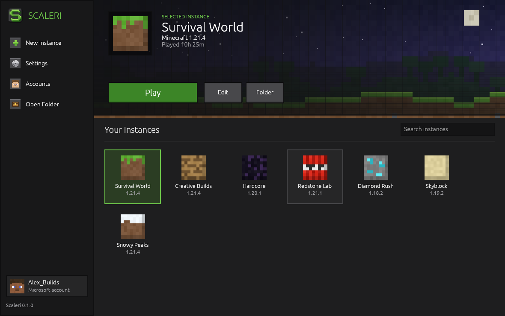
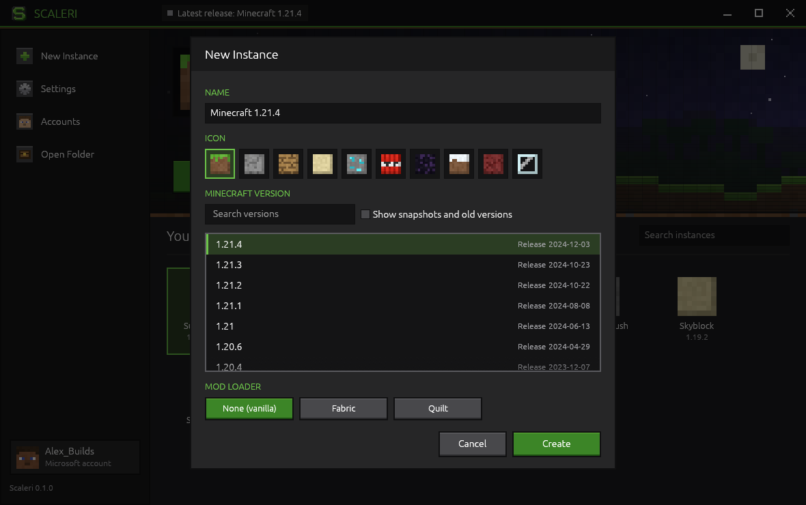
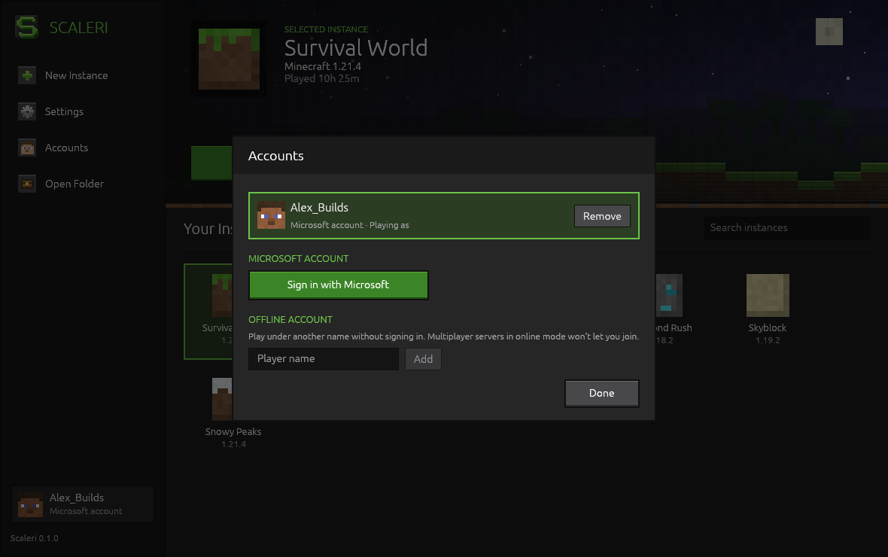

<p align="center">
  
</p>

<h1 align="center">Scaleri</h1>

<p align="center">
  A lightweight Minecraft: Java Edition launcher for Windows, written in Rust.
</p>

<p align="center">
  
</p>

## What it does

- **Instances.** Keep separate Minecraft installations, each with its own version, worlds, settings, icon and memory.
- **Every vanilla version.** Pick any release, snapshot, beta or alpha from Mojang's version list. Scaleri downloads the
  game, its libraries and assets, and checks every file against Mojang's checksums.
- **No Java install needed.** Scaleri downloads the Java runtime each version needs from Mojang, like the official
  launcher does.
- **Microsoft sign-in.** Sign in with a code in your browser; Scaleri keeps you signed in. Offline accounts are available
  once a Microsoft account that owns the game has been added.
- **Light in the background.** By default Scaleri closes as soon as the game starts, so it uses no memory while you play.
  Choose *Keep Scaleri open* in Settings if you'd rather keep it running to track play time. The launcher itself is a
  single ~6 MB executable with no installer.

<p align="center">
  
  
</p>

Scaleri started as a restyled fork of [Prism Launcher](https://github.com/PrismLauncher/PrismLauncher) and was then
rewritten from scratch in Rust. Mod loaders (Fabric, Quilt, Forge, NeoForge), modpacks and a mod browser aren't in the
Rust version yet.

## Microsoft sign-in

Scaleri signs in with its own Azure application (`174db889-6412-4846-869e-faafd5a578d0`), which Microsoft has approved
for the Minecraft services, so sign-in works out of the box. Builds can use a different approved application by setting
the `SCALERI_MSA_CLIENT_ID` environment variable (or the `MSA_CLIENT_ID` repository secret in CI), and players can paste
one into *Settings → Microsoft sign-in*.

## Building

Install [Rust](https://rustup.rs) on Windows, then:

```sh
cargo build --release
```

The launcher is `target\release\scaleri.exe`. Every pull request is built by GitHub Actions, and the executable is
attached to the run as the `Scaleri-Windows-x64` artifact. Pushing a `v*` tag creates a draft release with it.

Scaleri keeps its files in `%APPDATA%\Scaleri` (set `SCALERI_DATA_DIR` to use another folder):

```text
settings.json, accounts.json
instances\<name>\instance.json      the instance's version, icon and play time
instances\<name>\minecraft\         worlds, options, resource packs, screenshots
versions\, libraries\, assets\      game files shared by all instances
runtimes\                           Java runtimes from Mojang
```

## Code layout

| File | What it does |
| --- | --- |
| `src/accounts.rs` | Accounts and the Microsoft → Xbox Live → Minecraft sign-in |
| `src/versions.rs` | Mojang's version list, version files, library rules and assets |
| `src/java.rs` | Downloading Mojang's Java runtimes |
| `src/launch.rs` | Downloading what an instance needs, building the command line and starting the game |
| `src/net.rs` | HTTP, verified downloads and the parallel download queue |
| `src/ui/` | The window: home screen, dialogs, theme and the procedural pixel art |

## License

Scaleri is free software under the GNU General Public License v3.0. See [LICENSE](LICENSE). Minecraft is a trademark of
Mojang Studios; Scaleri is not affiliated with Mojang or Microsoft.
